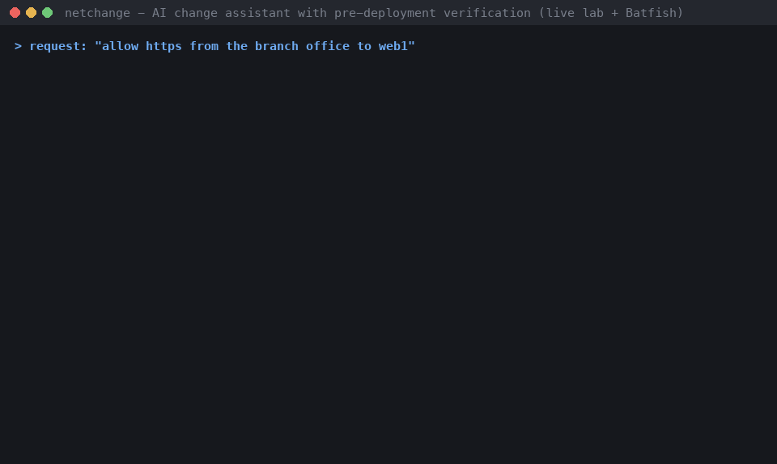

# AI network-change assistant with pre-deployment verification

An operator types a change in plain language, such as *"allow HTTPS from the branch office to web1"*.
An LLM turns it into a structured intent and writes the config. **Nothing reaches the network until a
model of the network proves the change does what was asked, breaks no policy, and changes no other
traffic.** Approved changes are applied to a live Containerlab network, tested with real traffic,
and rolled back automatically if the live checks fail.

The point: the AI's proposal is accepted because it was **checked against network behaviour**, not because the text looks reasonable.



*Real run on the live lab (`make demo`). In this recording the intents are given structured and the configs come from the reference compiler. The Batfish checks, live probes and rollback are all real.*

```mermaid
flowchart LR
    R["request<br/>(plain language)"] --> I["intent<br/>Claude → typed schema"]
    I -->|clarify / refuse| X1[[stop]]
    I --> G["candidate config<br/>Claude or reference compiler"]
    G --> L["dialect lint<br/>verifier-safe iptables"]
    L --> B["Batfish model<br/>parse · OSPF · loops · 14 invariants"]
    B --> S["intent checks<br/>post-conditions + out-of-scope<br/>differential reachability"]
    L & B & S -->|counterexample| G
    S --> A["approval gate<br/>risk policy"]
    A --> P["pre-flight probes<br/>(live network healthy?)"]
    P --> D["apply to Containerlab<br/>frr-reload · iptables-restore"]
    D --> T["live probes<br/>open / refused / blocked"]
    T -->|fail| RB["rollback<br/>verified against pre-flight"]
    T -->|pass| OK[[applied + audit log]]
```



## The network

There are six FRR routers running OSPF and six hosts, in 12 containers. Access policy lives in the
host firewalls on the servers. Batfish models those, but not packet filters on FRR routers; see the
[findings](docs/FINDINGS.md).

```
            hq (hq-users 10.1.10/24, mgmt 10.1.99/24)
           /  \
  branch--core1--core2--guest (guest-wifi 10.4.10/24)
 (10.2.10/24) \  /
               dc (web 10.3.10/24: web1 · db 10.3.20/24: db1)
```

Rules that must always hold ([`network/invariants.yml`](network/invariants.yml)):

| Kind | Rule |
|---|---|
| deny | guest Wi-Fi never reaches a server, on any port |
| deny | branch users never reach the database |
| only | database port 5432 is reachable only from the web tier |
| only | SSH to servers is reachable only from the management network |
| require | five business flows keep working, e.g. HQ to web1 on HTTPS, web1 to db1 on 5432 |
| routing | full OSPF adjacency, every router loopback reachable, no forwarding loops |

## What each layer catches

| Layer | Catches | Example from the evaluation |
|---|---|---|
| Intent parser | vague, unsupported or out-of-catalogue requests | "Open the web server to the branch" → *which port?* |
| Dialect lint | constructs Batfish mis-models | `-i lo -j ACCEPT` (Batfish treats it as match-all) |
| Batfish invariants | policy violations, broken routing | guest to web1:443 → `guest-isolated-from-datacenter`, with the exact flow |
| Out-of-scope check | changes to traffic nobody asked for | a "branch HTTPS" rule that also opens ICMP and TCP/80 |
| Pre-flight | changing a network that is already broken | an existing blackhole on hq → refuse |
| Live probes + rollback | drift between the model and reality | an out-of-band blackhole → change rolled back |

## Results

The evaluation covers 61 labelled requests that have a ground-truth intent, run against the live lab
(`make eval-template`):
- 21 valid changes;
- 8 requests already in place;
- 28 that break the policy;
- 4 live faults.

The change is written by the reference compiler, so every bad change here comes from the
**request**, and the comparison isolates what each **checking layer** catches. Raw per-request
records are in [`docs/eval/`](docs/eval/).

| | **Full pipeline** | Live tests + rollback only | No checks |
|---|---|---|---|
| Valid changes completed | **29/29** | 29/29 | 29/29 |
| Legitimate changes wrongly rejected | **0** | 0 | 0 |
| Policy-violating changes stopped *before* the network | **28/28** | 0/28 | 0/28 |
| Unsafe changes that reached the network | **0** | 28 | 28 |
| Unsafe changes **still live** at the end | **0** | **9** | 28 |
| Unintended reachability changes left live | **0** | 4 | 4 |
| Live faults handled (drift rollback, pre-flight refusal) | **2/2** | 2/2 | 0/2 |
| Rollback success | 1/1 | 20/20 | – |
| Time to apply a change, p50 / p95 | 6.9 s / 9.8 s | 6.9 s / 9.7 s | 2.7 s / 5.5 s |
| Time to reject a bad change, p50 | **2.4 s** | – | – |

**Why live testing alone is not enough.** With only live probes and rollback:
- 19 of the 28 bad changes were caught, but only *after* they were already in the network.
- **9 were never caught at all.**
  - Five opened ports the probes don't sample. For example, "guest Wi-Fi to db1 on HTTPS": db1 runs no HTTPS service, so no probe looks at port 443.
  - Four widened access through stateless return rules. No probe is designed to look for that.

Batfish reasons about every possible packet rather than a sample, so the full pipeline stopped all 28 before deployment, in about 2.4 s each.

**Next: Claude writing the configs.** `make eval-llm` runs the same requests in plain language, with
Claude writing the config. It adds the layers one at a time (LLM only, + lint, + Batfish, + intent
checks, + repair, full), measuring what each one catches when the *generator* makes mistakes too.

## Findings

There are more details in [docs/FINDINGS.md](docs/FINDINGS.md).

1. **The checker can be wrong.** Batfish treats `-i lo -j ACCEPT` as "match everything" (fail-open, no warning). It silently never matches port ranges, `multiport`, comma lists or `-m comment`. The pipeline enforces a dialect the checker models exactly, tested construct by construct by [`scripts/probe_batfish_iptables.py`](scripts/probe_batfish_iptables.py).
2. **Stateless return rules widen access.** Letting web1 reach db1 on a new port needs a return rule, and that rule opens web1 to db1 on any port from that source port. The scope check rejects it.
3. **The model is not the network.** Drift and absent services only show up live. Pre-flight probes and rollback checked against the pre-flight snapshot cover that gap.

## Run it

For a hosted, read-only portfolio viewer, use the root **`streamlit_app.py`** entry point.
It displays the committed evaluation, recorded requests, counterexamples, topology and demo without Docker or API keys.
See [docs/STREAMLIT.md](docs/STREAMLIT.md) for local preview and Streamlit Community Cloud deployment settings.

You need Docker (tested on Docker Desktop, Apple Silicon) and [uv](https://docs.astral.sh/uv/).

```bash
make setup images batfish      # venv, lab images, Batfish on :9996
make lab-up                    # 12-node Containerlab lab, OSPF converges in ~30 s
make verify                    # committed network vs every invariant
make test                      # 40 tests (Batfish tests run when the service is up)
make eval-template             # evaluation with gold intents, no LLM, free

# LLM path (needs Anthropic credentials: `ant auth login` or ANTHROPIC_API_KEY)
.venv/bin/netchange request "allow https from the branch office to web1"
make eval-llm                  # layer-by-layer ablation with Claude (costs API credits)
```

Every run is appended to `runs/audit.jsonl` with the request, intent, every attempt and its counterexamples, the diff, the probes and the timings.

## Layout

```
network/      topology.yml (source of truth), routers/*/frr.conf, hosts/*/iptables.rules, invariants.yml
src/netchange/
  topology.py   render.py    configs.py         typed model -> Batfish snapshot + Containerlab
  verify.py     iptables_lint.py                invariants, intent post-conditions, scope (differential reachability)
  intent.py     llm.py       pipeline.py        intent schema + reference compiler, Claude steps, orchestration
  lab.py        probes.py    evaluate.py  cli.py
scripts/      probe_batfish_iptables.py, make_requests.py, label_requests.py
data/         requests.jsonl (83 labelled requests)
docs/         FINDINGS.md, iptables_fidelity.json, eval/
lab/          router + host images
```

## Related work

- Mondal et al., *What do LLMs need to synthesize correct router configurations?* (HotNets 2023). Verified Prompt Programming: GPT-4 plus Batfish feedback.
- Wang et al., *NetConfEval: Can LLMs Facilitate Network Configuration?* (CoNEXT 2024).
- IRTF NMRG, *Network Digital Twin: Concepts and Reference Architecture* (draft-irtf-nmrg-network-digital-twin-arch). The Batfish model plus the Containerlab lab work as a config twin and an emulation twin.
